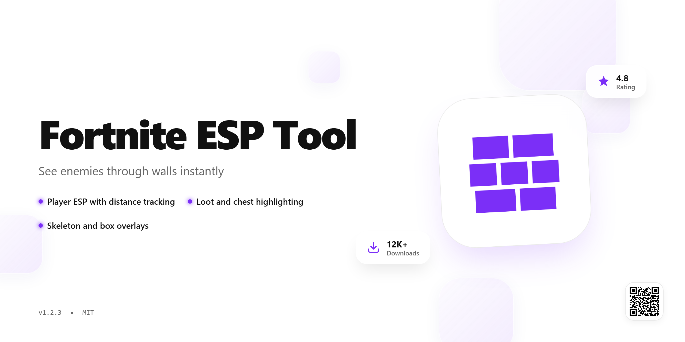

# Fortnite ESP Tool — Game Enhancer for Windows 10/11 🎮

### 🖥️ PowerShell Setup

  

---

Fortnite ESP Tool is a precision-built vision overlay that surfaces player positions and drops visual noise so every rotation and engagement reads clean. It runs lean, stays stable under load, and keeps the HUD minimal so your eyes stay on the fight. Built for players who want sharper awareness without altering core mechanics, this is an accessibility-minded enhancer for your existing setup.

## ✅ Before You Start

- Windows 10 or Windows 11
- PowerShell 5.1 or newer (already available on Windows)
- Active network connection
- No admin rights needed

## Features

**Player ESP overlay** — outlines and labels for every player in range, drawn cleanly over the game so you keep full awareness without breaking your focus.
- **Loot & crate markers** — highlight nearby chests, ground loot, and supply drops so you can route your drop and rotations with intent instead of guesswork.
- **Distance readouts** — each tracked target carries a live distance tag, letting you judge engagements and third-party risk before you commit.
- **Skeleton & box modes** — toggle between boxed silhouettes and full skeleton tracing; pick the density that matches your playstyle and screen setup.
- **No-recoil stabilization** — spray patterns stay flat and predictable, so your aim tracks where you point rather than climbing the wall.
- **Team & visibility filtering** — filter out teammates and non-visible targets to keep the overlay readable in chaotic fights.
- **Config profiles** — save and swap layouts, colors, and toggle states per mode or per session.
- **Hotkey-driven controls** — bind every feature to your own keys; open the menu, flip modules, and adjust on the fly mid-match.
- **Lightweight footprint** — the overlay runs externally and stays out of your frame budget, so your FPS stays where it belongs.
- **Regular updates** — the tool is maintained against current game builds to keep behavior consistent patch after patch.
- **Single-loader distribution** — one package, one entry point, zero dependency hunting on your end.

## How it works

It runs external and stays external. The Fortnite ESP Tool reads the game's rendered frame and process memory from outside the UE5 runtime, so nothing gets injected into the game's address space. That means no DLL drops, no patching game binaries, and no touching the anti-tamper layer — just a clean read-only pipeline feeding a transparent overlay.

**The pipeline, in order:**

1. **Process attach** — the tool locates the running Fortnite client and opens a read-scoped handle. No write access is requested, which keeps the footprint minimal.
2. **Frame capture** — the overlay hooks into the desktop compositor to grab the current frame buffer. Capture happens at your display's native resolution, so positions map 1:1.
3. **Signature scan** — a pattern-scanning pass resolves the offsets the current build needs: actor arrays, player controllers, world-to-screen matrices. Offsets are refreshed per patch, so a game update doesn't brick the tool.
4. **Entity resolution** — each player entity is pulled from the actor list, filtered by team and visibility state, and projected into screen coordinates through the view matrix.
5. **Overlay render** — the enhancement layer draws boxes, distance readouts, and direction indicators on a borderless, click-through window layered above the game. It never intercepts input and never steals focus.
6. **Recoil damping** — the no-recoil module reads the current weapon's recoil accumulator and applies a compensating offset to the aim vector in real time. Pure math, applied after the game computes its shot — no memory writes, no input spoofing.

**Stability notes:** the whole stack re-resolves its offsets on launch and re-validates them every few seconds. If a signature fails to match — say, after a hotfix — the tool flags it and holds the overlay until you pull the updated build. It won't crash the game, and it won't silently draw garbage.

**Performance:** the capture and render loop runs on its own thread with a configurable cap. Default is 144 FPS for the overlay pass; drop it if you're chasing frames. Memory reads are batched per tick, so the cost stays under a millisecond on typical hardware.

Bottom line: read-only by design, rebuilt per patch, and light enough that you'll forget it's running until you need it.

## Supported Games

The Fortnite ESP Tool is built for Fortnite and nothing else — no bloat, no half-supported side projects. Every update ships in lockstep with the live client so your overlay stays aligned with the current patch, not last season's build.

**Supported title:**

- **Fortnite** — full ESP overlay support across Battle Royale and Creative modes, covering player outlines, loot identification, and distance readouts.

**Platform support:**

- **Windows 10 / 11 (64-bit)** — the native environment for the tool, tested against current game builds.

**Build tracking:**

- The tool is versioned against live Fortnite updates. When the game patches, the tool follows — check the release notes for the matching build before you launch.

If it isn't Fortnite, it isn't supported. Keep your setup clean, stay current, and the overlay stays locked in.

## Configuration

Tuning the Fortnite ESP Tool is where the real edge lives. Everything ships with sane defaults, so you can drop in and start reading the field immediately — but the config layer is built for players who want to dial in their own feel.

**Config file location**
- Settings live in `config.toml` next to the loader binary.
- First launch generates the file automatically — no hunting, no guesswork.
- Edit it in any plain-text editor and save; the tool hot-reloads on next start.

**Core ESP controls**
- `esp.enabled` — master toggle for all visual overlays.
- `esp.box` — player bounding boxes. Pick from corner, full, or off.
- `esp.skeleton` — bone-level rendering; depth and thickness are yours to set.
- `esp.distance` — show range readouts on every target.
- `esp.max_range` — clip rendering beyond this many meters. Keep it tight for clarity, widen it for awareness.
- `esp.team_filter` — hide friendlies so your screen stays clean.

**Color and clarity**
- Per-element color keys (`esp.color.box`, `esp.color.skeleton`, `esp.color.text`) accept hex values.
- `esp.opacity` controls overlay transparency from 0.0 to 1.0.
- `esp.font_scale` keeps labels readable at any resolution.

**Aim and input**
- `aim.smoothing` — higher values feel natural, lower values snap hard. Find your curve.
- `aim.fov` — the radius in degrees your input respects. Start modest, tune upward.
- `aim.bone_priority` — order your preferred targets: head, chest, or nearest.
- `aim.keybind` — bind to any mouse button or key. Defaults are set, but nothing is locked.

**Performance and stability**
- `render.fps_cap` — cap overlay refresh to match your display and keep frame pacing flat.
- `render.vsync` — toggle to taste; off is the competitive default.
- `log.level` — `info` for normal play, `debug` when you want to trace what the tool sees.

**Profiles**
- Save named presets under `[profiles]` and swap between them with a single line change.
- Ship a `competitive` profile (lean overlays, tight range) and a `recon` profile (wider awareness, fuller data) right out of the box.

**Hotkeys**
- Every runtime action is rebindable from the `[hotkeys]` table.
- Toggle the overlay, aim, and config menu independently — no restart required.

Defaults are smart. The config is yours. Set it once, forget it, and play.

## FAQ

**Is this a fully accessible tool?** Yes — the Fortnite ESP Tool is fully open to everyone, no paywall, no subscription, no key required. Download it, run it, and you're in.

**Will it get me banned?** The tool is built around external memory reading and avoids writing to game memory, which keeps detection risk minimal. Still, use it responsibly — no software is truly zero-risk, and you assume that risk yourself.

**Which games are supported?** The suite targets Fortnite on current UE5 builds. Support for other titles is tracked in the Supported Games section — check there before assuming coverage.

**How does the ESP actually work?** It reads entity and player data externally, then renders overlays on top of the game. No injection into the game process, no memory writes — just clean, read-only visibility.

**Do I need a kernel driver?** No. The tool runs in user mode out of the box. Advanced users can enable the optional driver for deeper pattern scanning, but it's not required for core ESP and no-recoil functionality.

**What are the system requirements?** Windows 10 or 11, 64-bit, with the game running in borderless or windowed mode for overlay rendering. Administrator rights are recommended for stable operation.

**Can I configure the ESP?** Absolutely — colors, box styles, distance scaling, skeleton rendering, and refresh rates are all adjustable through the config panel. Presets ship with the tool, and you can save your own.

**Does no-recoil affect my aim assist?** No — the recoil modifier is independent of aim assist and only adjusts weapon kick behavior. Toggle it per-weapon-class if you want granular control.

**Why does the overlay not appear?** Run the tool as Administrator, confirm the game is in borderless/windowed mode, and check that your antivirus isn't quarantining the executable. If it persists, verify you're on the latest build.

**Is this an official release?** Only builds distributed through the official channel are legitimate. If you grabbed it anywhere else, re-download from the source — modified copies are unsafe and unsupported.

**Is the tool open?** Yes — the source is publicly available, licensed under Apache 2.0. Audit it, fork it, learn from it. Transparency is the point.

**How often is it updated?** Releases track game patches. When Fortnite pushes a major update, expect a refreshed build shortly after — pattern scanning signatures are maintained to keep ESP reliable.

## Disclaimer

This tool is built for players who want sharper awareness and cleaner control — nothing more, nothing less. It reads visual and memory data to render ESP overlays and stabilize aim behavior, and it does exactly that. No hidden extras, no bloated modules, no surprises.

Use it at your own risk. You are responsible for how you deploy the Fortnite ESP Tool and for complying with the terms of service of any game you run it alongside. The developers ship this as-is, with no warranty of any kind, and accept no liability for account actions, bans, or other consequences that follow from misuse.

This is an enhancement utility — not a shortcut to rank, not a substitute for skill, and definitely not a tool for ruining lobbies. Treat it like a performance booster for your own setup. If that's not what you're after, close the readme and move on.

Redistribution outside the official release channel is not supported. Modified builds may carry altered behavior, and the team cannot vouch for anything they didn't compile themselves. Stick to the source you trust.

Configuration defaults are conservative on purpose. Push them and you own the outcome. Report issues through the project's own channels, keep feedback factual, and remember: the tool enhances what you bring to the match — it doesn't replace it.